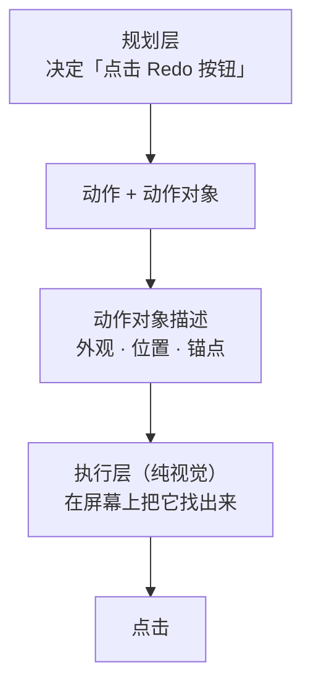

# ScreenSpot-Pro 元素定位 Benchmark

GUI 元素定位的评测框架：给定界面截图 + 目标元素描述，让模型/智能体输出落点，
用**命中率 + 落点质量**两层指标评估。

数据集：[`likaixin/ScreenSpot-Pro`](https://huggingface.co/datasets/likaixin/ScreenSpot-Pro)（1581 条 / 26 个应用）。

---

## 与 ScreenSpot-Pro 的关系

**一句话**：ScreenSpot-Pro 的输入是**任务词**，本仓库的输入是**元素描述**。

| | ScreenSpot-Pro 原始 | 本仓库 |
|---|---|---|
| 输入 | `instruction`：`"Redo"`、`"refresh"` | 4 字段结构化描述 |
| 性质 | 元素的**语义名** | 元素的**外观 + 位置 + 邻接** |
| 示例 | `powerpoint_windows_56` → `"Redo"` | `外观：红色向右弯曲的箭头符号，无文字`<br>`位置：屏幕水平【左侧】、垂直【上部】`<br>`锚点：撤销按钮右侧紧邻的图标` |

### 为什么要换

**做这个 benchmark 的目的，是为「纯视觉驱动的 Computer Use 智能体」评测定位能力。**

这类智能体**没有 DOM、没有无障碍树，只有像素**。它的执行链路是：



**执行层不能只拿到一个动作名。** `"Redo"` 这三个字母本身**不含任何视觉信息**——执行体必须知道：

| 需要知道什么 | 对应字段 |
|---|---|
| 目标**长什么样** | `feat` 外观特征 |
| 在屏幕**哪个区域** | `pos` 位置 |
| **旁边有什么**可以当参照 | `env` 锚点 |

**本 benchmark 的输入就是这份「动作对象描述」**——模拟的正是**真实应用场景下的定位问题**，而不是"模型认不认得这个按钮"。

| | ScreenSpot-Pro | 本仓库 |
|---|---|---|
| 输入处在链路哪一环 | **规划层**（用户/规划器说 `"Redo"`）| **执行层**（给执行体的动作对象描述）|
| 考的是什么 | 能否把**语义名**翻译成屏幕上的东西 | 能否按**描述**准确定位 |

**→ 两者互补：ScreenSpot-Pro 考「理解」，本仓库考「执行」。**

---

## 描述（descriptions/）

### 四个字段

| 字段 | 生成方式 | 内容 | 上限 |
|---|---|---|---|
| `feat` | **模型**（紧裁片 + 红框标出目标）| 外观特征 | 40 字 |
| `ctrl` | **规则推导** | `按钮` / `元素` | — |
| `pos` | **纯几何计算，不用模型** | 5×5 网格档位，如 `屏幕水平【左侧】、垂直【上部】` | — |
| `env` | **模型**（整图 + 上下文裁片 + 原分辨率条带）| 周边锚点，句式强制"X 的某部位" | 30 字 |

> **设计原则**：能确定性计算的绝不给模型——`pos` 由 bbox 直接算出，零随机性；模型只负责"看得见但算不出"的外观与锚点。

### 描述必须冻结成数据

`qwen3.8-flash` 是**浮动别名**，后端随供应商更新漂移——实测用**完全相同的请求参数**重跑，两条样例的外观描述发生了实质改变。**所以描述一旦生成就不能可靠地重新生成**，评测直接读 `descriptions/v<N>/`，绝不临时重新生成。

当前版本 **v2 覆盖全量 1581 条**（三个集合同一次生成、口径一致）。详见 [`descriptions/README.md`](descriptions/README.md)。

---

## 数据划分（splits/）

| 文件 | 条数 | 用途 | 允许调参 |
|---|---|---|---|
| `M1.json` | 20 | **开发 / 迭代** | ✅ |
| `M2.json` | 100 | **快速筛方案** | ❌ 冻结后跑 |
| `M3.json` | 1461 | **定成绩 / 最终验收** | ❌ |

**拆分逻辑**（可复现，`make_splits.py`）：

| 集合 | 怎么来的 |
|---|---|
| M1 | 前序实验用的**固定集合**（20 个 id 硬编码在 `make_splits.py`）|
| M2 | **`experiments/ab100/ids.txt` 的冻结集合**（50 条原失败 + 50 条原成功，seed 20261019）|
| M3 | **其余全部**（1461 条，含旧 M2 那 300 条）|

**三者互斥、合计 1581。**

**两条铁律**：
1. 划分一旦用于定成绩就**不许再改**——改种子等于换评测集，成绩不可比。
2. **在 M2 上看到成绩后不许回头调参**——那样 M2 就变成训练集；此时必须换 M3 报成绩。

⚠️ **M2 的命中率不能外推**：ab100 是 50% 原失败 + 50% 原成功的受控集，刻意放大了方案差异。
真实失败率约 17%，所以 **M2 只用来快速筛方案，最终成绩以 M3 为准**。

⚠️ **M1 有偏差，成绩不能外推**：目标长边中位 40px（全量 63px），小目标占比 50%（全量 36%）。

详见 [`splits/README.md`](splits/README.md) 与 [`docs/SPLITS.md`](docs/SPLITS.md)。

---

## 快速开始

```bash
pip install -r requirements.txt          # 只需 Pillow

# 1. 下载数据（约 3.1GB，8 并发约 20 分钟）
python3 scripts/download_data.py

# 2. 生成划分 M1/M2/M3
python3 scripts/make_splits.py

# 3. 生成描述（M1 已随仓库提供；M2/M3 需自行生成）
python3 scripts/gen_descriptions.py --split M1 --workers 8

# 4. 跑一个基线
export QW_KEY=...  QW_BASE=...            # 或 DS_KEY / DS_BASE
python3 baselines/b3_crop_ladder.py --split M1 --backend qwen --runs 5 --tag b3_qwen_M1

# 5. 出成绩
python3 scripts/evaluate.py 'baselines/results/raw/b3_qwen_M1_r*.jsonl' --labels 'B3·Qwen'
python3 scripts/make_report.py            # 汇总表 → baselines/RESULTS.md
```

或一键：

```bash
bash run_all.sh
```

---

## 三个基线（机制演进）

### 各自怎么做

| | 基线 | 决策者 | 机制 |
|---|---|---|---|
| **B1** | [`b1_direct.py`](baselines/b1_direct.py) | — | **零智能体参照**：整图缩放后 + 提示词，**一次调用直接出框**，没有循环 |
| **B2** | [`b2_agent_marker.py`](baselines/b2_agent_marker.py) | **模型** | **在图上画标记**：每轮把【整图 + 放大图 + **自己画过的标记**】送给模型，模型决定下一个标记放哪，反复调整，**直到自己调 `done()`** |
| **B3** | [`b3_crop_ladder.py`](baselines/b3_crop_ladder.py) ★ | **模型** | **只送裁片 + 阶梯扩大视野**（见下）|

**→ B2/B3 都是智能体模式（模型用工具自己决定下一步）；B1 是无循环的下界参照。**

**B2 与 B3 的关键分野**：**B2 始终在整图上操作**——标记画在整图上，模型得在整张 4K 图里找目标；**B3 只把候选区域裁出来送**，让目标占满视野。

### B3 方案

```
阶段1  整图 → 粗定位（= B1 的全部）
   ↓
阶段2  只把候选区域【裁出来】送模型，反复微调
       · 阶梯视野 200 → 400 → 800 → 1600 px
       · 每次放大 4×
       · 最多 5 轮，模型自己调 done() 结束
```

| 要点 | 为什么有效 |
|---|---|
| **只送裁片，不送全图** | 4K 全图里目标只有几十像素，缩到 2.5Mpx 后细节全丢；裁片让目标占满视野 |
| **阶梯扩大视野** | 先窄后宽——裁错了还能逐级退回，不会一步锁死 |
| **模型自己 `done()`** | 轮数自适应（实测平均 **2.62** 次），不是脚本硬编码流程 |

### 成绩

**最终验收（M3，1461 条 = 全量的 92%）**

| 基线 | 模型 | 命中 | 单次 | 调用 | 距边 | 擦边 | 宏观包裹 | 微观覆盖 |
|---|---|---|---|---|---|---|---|---|
| **B3** | qwen3.8-flash | **86%**（1257/1461）| 9.5s | 2.64 | 35% (+19%) | 40% (−9%) | 4.7% | 63.6% |

> M3 于 2026-10-23 由「旧 M3 1261 − ab100 100 + 旧 M2 300」合并而来，共 1461 条。
> 上表是把 B3 的两批历史结果按新集合重新汇总得到的，不是重跑。

**旧 M2（300 条分层抽样）的历史成绩** —— 该集合已于 2026-10-23 并入 M3，下表仅作历史参考

| 基线 | 模型 | 命中 | 单次 | 调用 | 距边 | 擦边 | 宏观包裹 | 微观覆盖 |
|---|---|---|---|---|---|---|---|---|
| **B3** | qwen3.8-flash | **86%** | 10.3s | 2.62 | **37%** | **39%** | 4.0% | **64.2%** |
| B2 | qwen3.8-flash | 84% | 12.1s | 2.66 | 31% | 43% | 3.7% | 59.1% |
| B1 | qwen3.8-flash | 74% | **2.1s** | **1.00** | 27% | 49% | 6.0% | 57.5% |

**新 M2（ab100，100 条受控集）的成绩**

| 基线 | 模型 | 命中 | 说明 |
|---|---|---|---|
| **B5**（解耦循环）| qwen3.8-flash | **79%**（79/100）| `b5_ab100_c1..c4` |
| **B3**（单次+阶梯）| qwen3.8-flash | **60%**（60/100）| `b3_ab100_bj_M3_v2_q38_s1..s10` |
| **B9**（pointer 提示词）| qwen3.8-flash | 跑测中 | 见 `baselines/results/raw/b9_ab100_c*.jsonl` |

> **ab100 上 79% 不等于全量 79%**：这个集合是 50% 原失败 + 50% 原成功的受控样本，
> 刻意放大了方案差异。B3 在这里只有 60%，而它在全量 M3 上是 86%——同一套方法，
> 换集合就差 26pp，可见集合难度差异有多大。**ab100 用来排序，M3 用来报分。**

> 随机基线：距边中位 **29%**、擦边率 **44%**。

**关键不是命中率，是落点质量**：B1/B2 的落点在框里基本是随便落的（B1 距边 27%、擦边 49%，都在随机线附近）；**只有 B3 两个指标都明确跨过随机线**（距边 +26%、擦边 −11%）。

**B2 的脆弱性**：换弱模型就崩——qwen3.7 上 B2 从 84% 掉到 **33%**（比零智能体的 B1 还差），调用数飙到 4.46，且**微观覆盖率中位数为 0.0%**（超过一半的样例框与真值完全不相交）；B3 在同一模型上仍有 74%。**"画标记"是结构性弱点，"只送裁片"没有。**

> ⚠️ M1 的 20 条偏难（目标长边中位 40px vs 全量 63px），**成绩不能外推**；正式成绩一律看 M2/M3。
> 完整成绩（含 3 个模型 × 2 个后端的对比）见 [`baselines/RESULTS.md`](baselines/RESULTS.md)。

---

## B9：pointer 提示词迁移实验（2026-10-23）

**目的**：把产品端（`crates/pointer-core/src/agents/computer/locate/`）的定位提示词搬到 benchmark，量它到底有没有用。

`baselines/b9_pointer_prompt.py` 是 `b5_decoupled.py` 的拷贝，只改提示词。跑在 ab100（= 新 M2）上。

### 结论先行：**locate 侧可以迁，verify 侧不能迁**

| 版本 | 改了什么 | ab100 命中 | 假阳性率 |
|---|---|---|---|
| **B5**（原版） | — | **79%** | 15.2% |
| **B9v1** | 只改 locate | **75%** / **71%**（两次跑） | 12.0% / 17.0% |
| B9v2 | locate + pointer 的 verify | **68%** | 23.0% |
| B9v3 | verify 分层（锚点看不到≠错） | 未跑全量 | — |
| B9v4 | v3 + 规则 4 豁免纯图标 | 未跑全量 | — |

**B9v1 是新的基准配置**：`pointer 的 locate 提示词 + B5 的 verify 提示词`。

**B9v1 跑了两次（75% 和 71%），差 4pp 在噪声范围内** —— ab100 只有 100 条，95% 置信区间约 ±8pp。
两次的判定行为分布高度一致，说明配置确实复现了：

| | 第 1 次 | 第 2 次 |
|---|---|---|
| 判 yes | 75 | 72 |
| `anchor_out_of_view` | 25 | 22 |
| `ambiguous` | 18 | 25 |
| `box_too_tight` | 3 | 7 |
| 平均轮次 | 1.64 | 1.72 |

**所以 B9v1 相对 B5 的真实差距（75/71 vs 79）在统计上分不出来**（McNemar p=0.503）。
能说的是：**它没有变差，而且落点更居中**（距边 41%/30% vs B5 的 37%，两次里有一次明显更好）。

### 为什么 verify 不能迁

**先记下 pointer 产品侧为什么要放宽（这个理由 benchmark 里不成立）：**

> 产品里主 LLM 和定位 LLM 用的是**不同的模型**。主 LLM 的视觉能力弱一些，
> 它给出的目标描述（尤其是「周边锚点」这类位置特征）**不一定准**。
> 所以定位侧的校验不能拿锚点当硬约束——描述本身可能就是错的，
> 因为描述不准而判 no，会把本来对的位置也否掉。

**这个理由在 benchmark 里不成立**：ab100 的 `env` 是人工标注的，锚点准确率远高于
主 LLM 现生成的描述。所以「锚点对不上就判 no」在这里是有效的纠错信号，
而不是误伤。

> **推论**：产品侧定位精度的上限，部分受限于主 LLM 的视觉能力。
> 定位 LLM 拿到的描述本身带噪声，它只能靠「放宽校验」兜底，代价是假阳性升高。
> **提升主 LLM 的描述质量（尤其是位置/锚点这类空间特征），是提高定位精度的前置条件** ——
> 描述准了，校验才敢收紧，假阳性才能压下去。
> 在那之前，产品侧的软约束是合理的权衡，不是缺陷。

**pointer 的 verify 里有两条：**

```
- 锚点和图中有出入，不单独构成判 no 的理由。
4. 外观、锚点有出入但文字和位置都对 → 仍然判 yes。
```

**这在产品里是必要的**（描述不可靠，不能当硬约束），**但在 benchmark 上是灾难**
（锚点是人工标注的，而且是区分同名元素的**唯一线索**）。

**实测证据（ab100 上的假阳性案例，逐个看原图确认过）：**

| 案例 | GT（绿框） | 模型选的（红框） | 只能靠锚点区分？ |
|---|---|---|---|
| `blender_windows_46` | Add→Mesh 菜单里的 **"Plane" 菜单项** | 右侧属性面板里的**物体名 "Plane"** | 是（两处都有 Plane 文字） |
| `illustrator_windows_29` | 三角形图标**正下方紧邻**的画笔 | 再往下一枚同类画笔 | 是（两枚画笔长得一样） |
| `davinci_macos_17` | POI+ 图标**右边第一个** | 同一行偏左的另一枚标记按钮 | 是（同行多个相似按钮） |

**三条的描述 `feat` 都有歧义，只有 `env`（周边锚点）能唯一确定。** 把锚点降级成「有出入也不影响判定」，等于把这批样本的判别依据删掉。

**模型的行为印证了这一点** —— B9v2 的假阳性里，why 直接写着：

```
blender_windows_46    "锚点提示框未显示但不影响判定"
origin_windows_36     "右侧数值框显示10非0，属锚点小出入"
quartus_windows_27    "锚点红色小人图标在工具..."
```

**它不是没看到矛盾，是提示词告诉它矛盾不重要。**

### 试过的三次补救，全部失败

| 版本 | 改法 | ab100 | 11 条验证 |
|---|---|---|---|
| B9v2 | 锚点完全软约束 | 68% | 5/11 |
| B9v3 | 分层：看不到≠错、看得到对不上=no | — | 4/11 |
| B9v4 | v3 + 规则 4 豁免纯图标（无文字元素） | — | 5/11 |

**11 条验证集 = 6 条 B9v2 的假阳性 + 5 条「B9v2 对但 B5 错」的回归检查。**

**B9v1 在同一批 11 条上是 7/11，最高。** 关键差异在 `premiere_windows_49` / `vivado_windows_0` / `vmware_macos_3` 三条 —— 它们都是「颜色/外观有出入但位置对」，原版严格锚点反而判对了。

**方向错了，改措辞救不回来。**

### locate 侧的改动确实有效

**B9v1 的改动（都留在 pointer 里）：**

1. **框规则改「先包住再收住」**
   原来写「框要刚好框住该元素本身（不要外扩、不要缩小）」，读起来像「保持紧」，会导致框只框住长文件名的一半。
   改成两个阶段：先完整包住（不够大就放大，不要怕松）→ 包住后允许比目标大一圈，只要**中心点落在目标上**。

2. **`【上一轮的情况】` 挪到 prompt 最后**
   原来拼在框规则前面，会被后面的「不要外扩」盖掉。挪到最后，成为模型读到的最后一句。

3. **新增 `unclear_kind=box_too_tight`**
   verify 看到「框里已是目标的一部分、另一部分在框外」时，判这个而不是 `no`；控制器据此**原地扩框 1.5 倍重验**，而不是换个地方重新找。
   ab100 上触发 3 次（100 条），1 次成功。

**效果**：命中率无显著变化（75% vs 79%，p=0.503），但**落点更居中** —— 距边 41% vs 37%（+40% vs +25% 相对随机基线），P75 误差 8px vs 7px。

**速度**：单条串行无并发时，B9 比 B5 略快或相当（4 条对比：−4% / −8% / −4% / +82%，慢的那条 trace 结构完全相同，是 API 波动）。**之前记录的「B9 慢 2.3 倍」是 16 个进程抢配额造成的假象。**

### 复现

```bash
# B9v1（新基准）：locate 用 pointer 版，verify 用 B5 原版
python3 scripts/run_parallel.py --baseline b9_pointer_prompt --split M2 --backend qwen \
    --shards 8 --extra "--coord-mode rel"

# B5（对照）
python3 scripts/run_parallel.py --baseline b5_decoupled --split M2 --backend qwen \
    --shards 8 --extra "--coord-mode rel"
```

**密钥放项目根 `.env`**（见 `.env.example`，已被 `.gitignore` 排除）。
**不要放 `/tmp`** —— macOS 会定期清理，之前 `/tmp/qw.env` 就被清掉过，跑到一半发现没 key。

---

## 指标：为什么不能只看命中率

| 指标 | 定义 | 回答什么 |
|---|---|---|
| **命中率** | 落点是否落在真值框内 | 找对了没有 |
| **距边·半边长** | `落点→最近边的距离 ÷ (目标长边/2)`；`0`=贴边，`1`=正中心 | 落点在框里**居不居中** |
| **擦边率** | 命中样本中，距边 < 0.25 的比例（落在最外 25% 环带）| 命中是**瞄准的还是碰巧的** |
| **宏观 完整包裹率** | 预测框**完整包住**真值框 → 记 1 | 框**够不够大** |
| **微观 平均覆盖率** | `min(1, 交集面积 ÷ 真值面积)` | 框**盖住目标多少** |

**为什么要后四个**：命中只说明"落在框里"。框有大有小——**落点可能在框里却贴在最边上，那和"瞎猜正好猜进去"没区别**。距边/擦边就是用来区分「真的瞄准了」和「碰巧框进去了」。

**为什么还要宏微观**：执行体的动作不同，需要的输出也不同——

| 动作 | 需要什么 | 对应指标 |
|---|---|---|
| **点击** | 一个**点** | 命中率 / 距边 / 擦边 |
| **框选 / 拖拽** | 一个**框** | **宏微观覆盖率** |

**只测落点会漏掉一半能力。**

> 实测：所有方案的**宏观完整包裹率都只有 2%–6%**，而微观覆盖率有 57%–64%——
> 说明模型报的框**基本都偏小**，能盖住目标的一部分，盖不住全部。
> 另外 B1 的宏观最高（6.0%）但命中最低（74%）：它的框更大（更容易包住）但中心偏。
> **→ 这两个指标是独立维度，不是重复度量。**

指标定义、随机基线推导与判读规则详见 [`docs/METRICS.md`](docs/METRICS.md)。
> ⚠️ **4pp 差距不显著**（86 vs 82，SE≈5.2pp）。选型请看落点质量与耗时，不要只看排名。

**核心结论**：
1. **智能体模式（模型自己决定下一步）全面优于脚本硬编码流程**——早期那代脚本驱动的校验循环
   在 qwen 上同样 82%，但慢 **2.3 倍**（18.5s），在 DS 上精度还输（70% < 74%），已被淘汰。
2. **B3 的"只送裁片"结构对弱模型收益最大**——同一个 qwen3.7-flash，
   从旧机制 33% 提升到 71%（**+38pp**），全错样例从 10/20 降到 2/20。

详见 [`baselines/README.md`](baselines/README.md)。

---

## 目录结构

```
screenspot_grid/
├── README.md              入口（本文件）
├── run_all.sh             一键复现
├── requirements.txt
├── .gitignore             排除 data/、baselines/results/、legacy/ 的旧结果
│
├── bench/                 核心库（可 import）
│   ├── dataset.py         数据集加载、图片下载缓存、坐标换算
│   ├── clients.py         模型客户端（DeepSeek / Qwen 统一接口）
│   ├── vision.py          缩放、裁片、画标记
│   ├── prompts.py         提示词与工具定义
│   ├── metrics.py         指标（命中率 + 落点质量 + 随机基线）
│   └── runner.py          基线共用的 CLI 驱动
│
├── baselines/             3 个基线脚本 + RESULTS.md（成绩汇总）+ results/raw/（原始逐条结果，不进 git）
├── scripts/               download_data / make_splits / gen_descriptions / evaluate / make_report
├── splits/                M1.json M2.json M3.json + 说明
├── descriptions/          每个样例的描述（M1 已冻结）+ 说明
├── docs/                  PROTOCOL / METRICS / SPLITS / ARCHIVE1-4（实验历史）
├── data/                  annotations/（上游标注）+ images/（图片缓存）—— 不进 git，download_data.py 可取回
└── legacy/                53 个实验脚本（入库，供 diff 复核）+ 旧结果（不进 git）
```

---

## 三条必读规则

### ① 数据集与图片不进版本库

`data/`（标注 + 图片 3.3GB）、`legacy/` 的旧结果、`baselines/results/`（原始逐条结果）已被 `.gitignore` 排除；**`legacy/` 的脚本**与成绩汇总表 `baselines/RESULTS.md` **进库**。
换机器只需跑 `scripts/download_data.py`。

### ② 描述是固定输入，**按版本冻结**

实测：用**原始脚本**重跑同样样例，产出的描述与已冻结版本**不一致**——
请求参数完全一致（PNG、`temperature=0`），差异来自模型本身（浮动别名会漂移）。

**因此描述按版本冻结**：`descriptions/v1/`（历史，只有 M1）、`descriptions/v2/`（当前，全量）。

| 版本 | 覆盖 | 说明 |
|---|---|---|
| **v1** | 只有 M1（20 条）| `docs/ARCHIVE*.md` 里的 M1 历史成绩用的就是它 |
| **v2** | M1+M2+M3（1581 条）| 三个集合同一次生成，**正式成绩一律用这版** |

基线通过 `--desc-version` 指定版本（默认 v2），**结果会自动记录版本**
（结果行 `desc_version` 字段 + 文件名带版本段 + 汇总表「描述版本」列）。
**跨版本的成绩不可比较。** 详见 [`descriptions/README.md`](descriptions/README.md)。

### ③ M1 调参 / M2 定成绩 / M3 验收

| 集合 | 条数 | 用途 |
|---|---|---|
| M1 | 20 | 迭代（随便试）|
| M2 | 100 | **冻结后才跑，跑完不许回头调参**（ab100 受控集）|
| M3 | 1461 | 定成绩 / 最终验收 |

**在 M2 上看到成绩后回头改提示词，M2 就变成了训练集。**
详见 [`docs/PROTOCOL.md`](docs/PROTOCOL.md)。

---

## 文档

| 文档 | 内容 |
|---|---|
| [`docs/PROTOCOL.md`](docs/PROTOCOL.md) | 评测协议、报告口径、可比性前提 |
| [`docs/METRICS.md`](docs/METRICS.md) | 指标定义与随机基线判读 |
| [`docs/SPLITS.md`](docs/SPLITS.md) | 划分规范与分布吻合度 |
| [`docs/ARCHIVE*.md`](docs/README.md) | 实验历史（38 节，含机制演进全过程）|

## 引用

数据集来自 ScreenSpot-Pro，请引用其原始工作：

```bibtex
@inproceedings{li2025screenspotpro,
  title={ScreenSpot-Pro: GUI Grounding for Professional High-Resolution Computer Use},
  author={Li, Kaixin and others},
  year={2025}
}
```

## 许可证

本仓库代码采用 [MIT 许可证](LICENSE)。
数据集 ScreenSpot-Pro 版权归原作者所有；本仓库不包含数据集文件（图片与标注由 `scripts/download_data.py` 从上游取回）。
